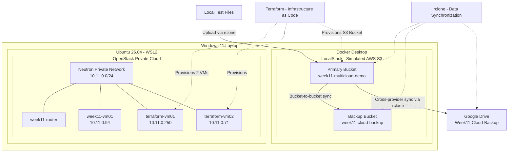

# Week 11 – Hybrid Cloud Architecture

## Architecture Description

This project demonstrates a hybrid-cloud lab environment using OpenStack, Terraform, LocalStack, rclone, and Google Drive.

### Private Cloud
OpenStack runs inside Ubuntu WSL2 and provides virtual machines, networking, and routing.

### Infrastructure Automation
Terraform provisions two OpenStack virtual machines and an S3-compatible bucket in LocalStack.

### Simulated AWS Storage
LocalStack runs through Docker Desktop and provides simulated AWS S3 storage.

### Data Synchronization
rclone synchronizes files from local storage to LocalStack S3, between LocalStack buckets, and from LocalStack S3 to Google Drive.

### Data Integrity
SHA-256 checksums and rclone verification confirm that the synchronized files match.

### Limitation
LocalStack persistence across container restarts was not functioning reliably during testing. Terraform and rclone were used to restore the resources.
